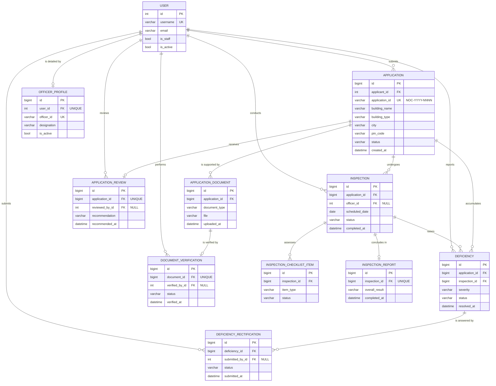

# Entity Relationship Model

Conceptual data model for the FireNOC Management System, describing the
entities the Fire Department works with and how they relate to one another.
This document records the model as currently implemented; the physical table
definitions are in [relational-schema.md](relational-schema.md).

---

## 1. Entities

| Entity | Represents | Owning module |
|---|---|---|
| **User** | Any person who signs in: applicant, fire officer or administrator | Django `auth` |
| **OfficerProfile** | Fire department staff details attached to a user account | Officer |
| **Application** | A request for a Fire NOC for one building | Applicant |
| **ApplicationDocument** | A file uploaded in support of an application | Applicant |
| **DocumentVerification** | An officer's accept/reject decision on one document | Officer |
| **ApplicationReview** | An officer's desk review and final recommendation | Officer |
| **Inspection** | A scheduled or completed site visit | Officer |
| **InspectionChecklistItem** | One fire-safety item assessed during an inspection | Officer |
| **InspectionReport** | The summary outcome of a completed inspection | Officer |
| **Deficiency** | A safety shortcoming recorded against an application | Officer |
| **DeficiencyRectification** | An applicant's evidence that a deficiency was fixed | Officer |

A **User** takes one of three roles. The role is not a column: an applicant is
a plain user, an officer is a user that owns an `OfficerProfile`, and an
administrator is a user with the `is_staff` flag set.

---

## 2. Diagram

---

## 3. Relationships

| # | Parent | Child | Cardinality | Child participation | Meaning |
|---|---|---|---|---|---|
| R1 | User | Application | 1 : N | Total | An applicant may file many applications; every application has exactly one applicant |
| R2 | User | OfficerProfile | 1 : 1 | Total | A profile belongs to exactly one user account |
| R3 | Application | ApplicationDocument | 1 : N | Total | Supporting files belong to one application |
| R4 | ApplicationDocument | DocumentVerification | 1 : 1 | Total | Each document is verified at most once |
| R5 | Application | ApplicationReview | 1 : 1 | Total | One desk review per application |
| R6 | Application | Inspection | 1 : N | Total | Re-inspection creates a further row rather than overwriting |
| R7 | Inspection | InspectionChecklistItem | 1 : N | Total | One row per safety item assessed |
| R8 | Inspection | InspectionReport | 1 : 1 | Total | A completed inspection yields one report |
| R9 | Application | Deficiency | 1 : N | Total | Deficiencies are tracked per application |
| R10 | Inspection | Deficiency | 1 : N | Total | Each deficiency also records the visit that found it |
| R11 | Deficiency | DeficiencyRectification | 1 : N | Total | An applicant may submit evidence repeatedly until accepted |
| R12 | User | DocumentVerification | 1 : N | Partial | The verifying officer; nullable so history survives account deletion |
| R13 | User | ApplicationReview | 1 : N | Partial | Reviewing officer and recommending officer, recorded separately |
| R14 | User | Inspection | 1 : N | Partial | The officer who conducted the visit |
| R15 | User | Deficiency | 1 : N | Partial | Reporting officer and closing officer, recorded separately |
| R16 | User | DeficiencyRectification | 1 : N | Partial | Submitting applicant and reviewing officer |

**Participation** is read from the child side. *Total* means the foreign key is
`NOT NULL`, so a child row cannot exist without its parent. *Partial* means the
column is nullable.

Relationships R12 to R16 use `ON DELETE SET NULL` rather than `CASCADE`: if a
staff account is removed, the inspection and verification history must survive,
because it is the evidence behind a certificate decision. Ownership
relationships (R1, R3, R6 to R11) use `ON DELETE CASCADE`, since a document or
checklist item is meaningless without its parent.

Note that `Deficiency` carries a foreign key to both `Application` (R9) and
`Inspection` (R10), and `Inspection` already references `Application`. The
application reference is therefore derivable through the inspection. It is kept
because deficiency lists are filtered by application on every officer screen,
and the direct key avoids a join on the hottest query in that module.

---

## 4. Identifiers

| Entity | Surrogate key | Business key |
|---|---|---|
| Application | `id` | `application_id`, formatted `NOC-YYYY-NNNN` |
| OfficerProfile | `id` | `officer_id` |
| User | `id` | `username` |
| All others | `id` | none; identified through their parent |

Every table uses a database-generated surrogate primary key. Business keys that
exist are additionally constrained `UNIQUE`. `application_id` is assigned after
insert, because it embeds the row's own primary key.

`InspectionChecklistItem` has a composite uniqueness rule rather than a business
key: `(inspection_id, item_type)` must be unique, so one inspection cannot record
the same safety item twice.

---

## 5. Business rules the model enforces

1. An application belongs to exactly one registered user.
2. A document cannot exist without the application it supports.
3. An application is reviewed at most once, but may be inspected many times.
4. A deficiency always names both the application and the inspection that found it.
5. An officer account cannot be reused as an applicant identity, because officer
   details live in a separate `OfficerProfile` row rather than in extra user columns.
6. Deleting a staff account never deletes inspection or verification history.

---

## 6. Entities planned but not yet implemented

The model above is incomplete with respect to the project's scope. Three
entities are added by later work in the Admin, Database and NOC module:

| Entity | Why it is needed | Introduced in |
|---|---|---|
| **Building** | `Application` currently stores nine building columns inline, so a renewal duplicates every one of them | Normalization work |
| **ApplicantProfile** | Applicant name and mobile are repeated on every application rather than held once per person | Normalization work |
| **PinCode** | `pin_code` determines `city` and `state`, which are currently stored once per application | Normalization work |
| **NOC** | The issued certificate has no table at all, so an approved application cannot record its certificate number, issue date or validity | NOC issuance work |
| **AuditLog** | No table records who changed what, which the problem statement requires for monitoring | Audit work |

The reasoning behind these entities, and the functional dependencies that
require them, is set out in [normalization.md](normalization.md).
